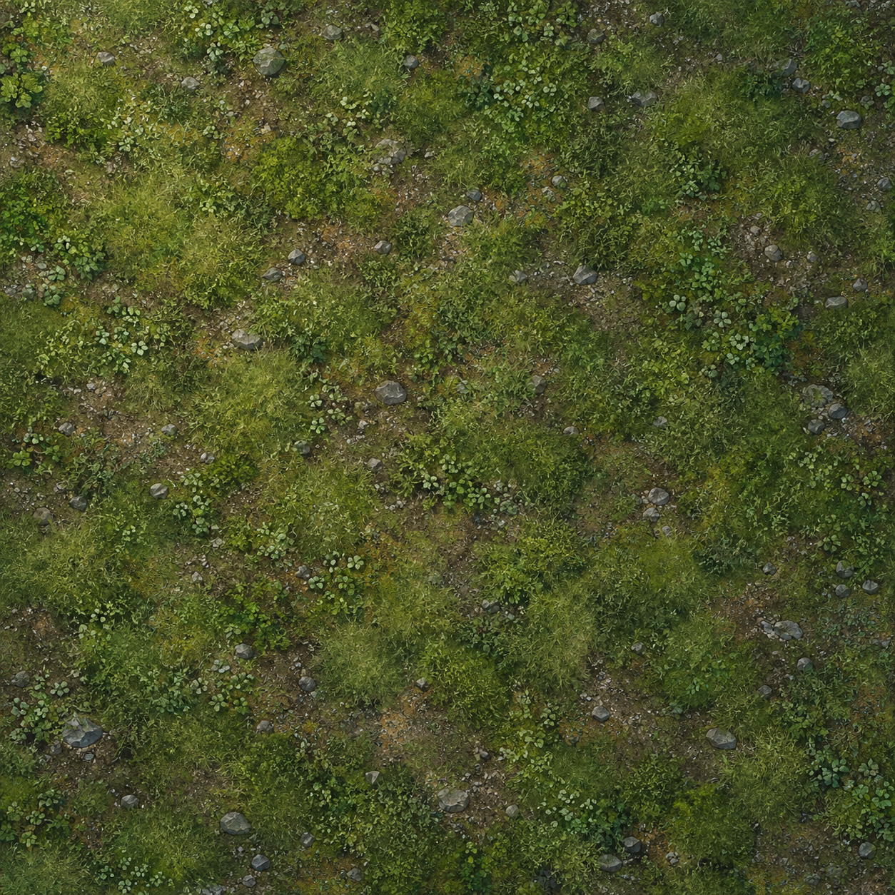
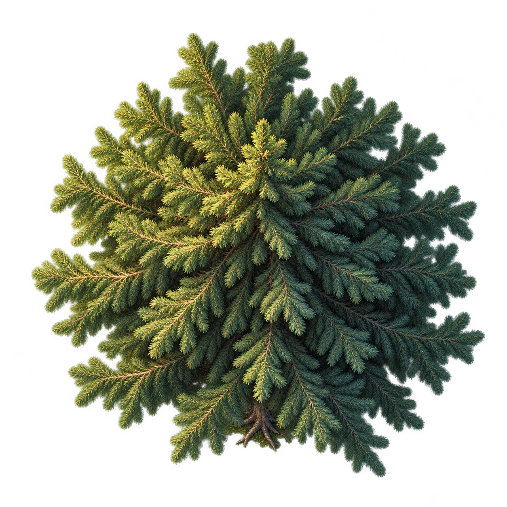
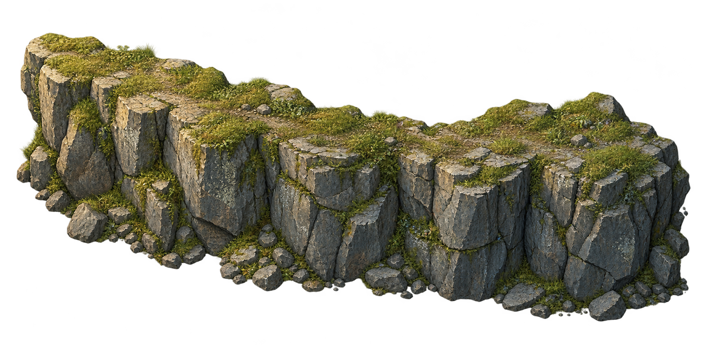

# 地表、树木、岩壁 · 风格样张 V1

制作日期：2026-10-13。状态：**待用户评审（in_review）**。本目录用于确定地图美术方向，尚未接入游戏运行时。

## 统一的风格目标

- 原创半写实绘画质感，保留自然材质与明确体积；地图采用高角度俯视表达。
- 地表为低饱和草绿、暖褐泥土与灰色碎石；针叶树为深绿；岩壁为冷灰岩层配苔草。
- 左上柔和暖光、右下冷影；不将带方向光的贴图任意旋转来补齐方向。
- 三张均为独立图片，不含人物、格线、文字或 UI。

## 样张

| 内容 | 文件 | 实际尺寸 | 透明通道 | 当前用途 |
| --- | --- | --- | --- | --- |
| 草土碎石地表 | [ground-style-v1.png](ground-style-v1.png) | 1254×1254 | 无，RGB | 地面色板、材质密度与草土关系 |
| 俯视针叶树 | [tree-style-v1.png](tree-style-v1.png) | 1254×1254 | 有，RGBA | 树冠层次、枝叶体积与投影方向 |
| 苔草岩壁 | [cliff-style-v1.png](cliff-style-v1.png) | 1774×887 | 有，RGBA | 岩顶、立面、裂隙与岩脚关系 |

### 地表

### 树木

树木初稿视角偏正面，已用内置 image_gen 修正为更强的俯视树冠；保留针叶纹理、配色与光照。黑色预览区域并非图片中的实底，实际透明度已检查。

### 岩壁

## 已验证与尚待制作

三张原始 PNG 均可解码；树木与岩壁包含真实 Alpha，透明度范围为 0–255。文件复制到项目后保持原始像素与 Alpha，具体尺寸、文件大小和 SHA-256 见 [manifest.json](manifest.json)。完整生成提示词及树木视角修正提示词见 [prompts.json](prompts.json)，使用内置 image_gen，未使用 CLI/API 回退。

这些检查仅确认文件有效和真实透明通道。地表尚未进行无缝平铺验证，画面细节较丰富，正式战斗地表需要试验较低密度的变体；岩壁尚未制作可连接的直段、内外角和端头。透明景物的边缘色、与地表的组合效果、准确投影一致性、世界尺寸与锚点也需要在正式制作中检查，不能将提示词中的目标摄像角度当作已测量的参数。

下一步先评审三张的材质、色板、光向与体积，确认后制作可铺装资源，并在 60% / 100% / 185% 缩放下验证人物可读性与地形边界。第一块样片继续遵循 [模块化地图素材计划](../../../docs/MAP-ASSET-PIPELINE.md)，保持 10×8 规则格与现有移动、攻击、胜负规则。
